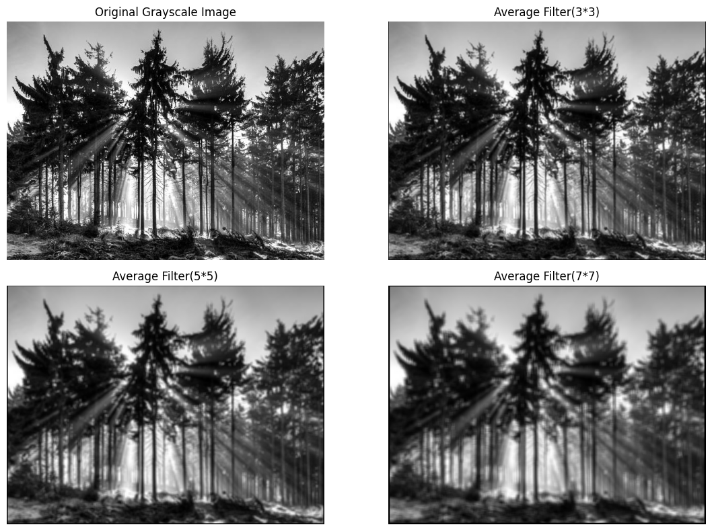

CV Lab-3: Image Filtering

Aim

To perform image filtering using Python and OpenCV.

Input Image

Output Image

Result

Image filtering was performed successfully using Python and OpenCV.

---

Author: G. Balaji
